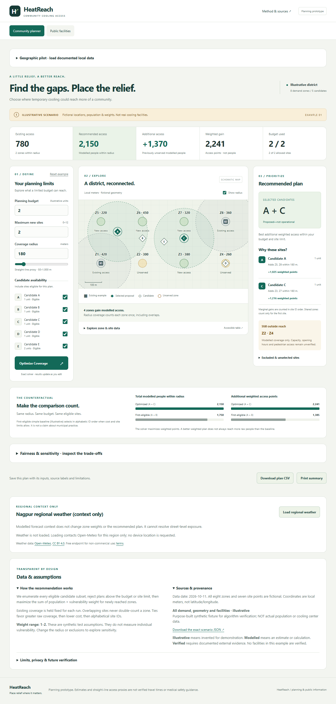

# HeatReach

**Find the communities cooling infrastructure misses. Place relief where it matters.**

A working, browser-only community cooling-access planner for campus administrators, NGOs and ward planners. Adjust a budget, site cap, radius and candidate availability. An exact optimizer recommends the feasible subset with the greatest additional vulnerability-weighted access and compares it with an explicitly defined simple baseline.

**The default demonstration is entirely illustrative.** Locations, populations, weights, facilities and costs are synthetic. Proposed sites are not operational cooling centers. P1 supports importing documented geographic inputs; P2 provides a separate public directory, currently empty because no verified inventory was supplied. Straight-line coverage is not verified walking access or a health outcome.



The interface follows the supplied Stitch design: warm ivory, terracotta and slate-blue surfaces, self-hosted typography, responsive navigation and a map/table switch. See [design integration](docs/DESIGN.md).

## Run locally

Prerequisites: Node.js **22.12 or newer** (Node 22 LTS recommended), npm, and a modern browser. No API keys, database or backend.

```sh
npm ci
npm run dev
```

Open the printed local URL, normally `http://127.0.0.1:5173`. The default planner works without external APIs after the local server starts. Weather and geographic map tiles make third-party requests only when explicitly loaded. It is not a service-worker offline installation.

```sh
npm test                 # Vitest domain + React tests
npm run typecheck        # strict TypeScript
npm run build            # typecheck + Vite -> dist/
npm run preview          # serve production build
npm run test:e2e          # real Edge browser; builds must already exist
npm run format:check
```

Browser tests use installed Microsoft Edge. On Linux/macOS CI, install an appropriate supported Playwright browser and update `channel` in `playwright.config.ts`, or install Edge with `npx playwright install msedge` where supported. Domain/UI tests and production builds do not require Edge.

## Verified benchmark

At budget 2, cap 2, radius 180 meters:

| Calculation | Exact result |
|---|---:|
| Existing coverage | Z1, Z8 / 780 modelled people |
| Selected proposals | A + C |
| Newly covered zones | Z3, Z5, Z6, Z7 |
| Optimized total | 2,150 modelled people |
| Additional raw access | 1,370 modelled people |
| Optimized weighted gain | 2,241 access points |
| Baseline selection | A + B |
| Baseline total | 1,750 modelled people |
| Baseline weighted gain | 1,385 access points |
| Budget 1 selection / total | C / 1,480 modelled people |

All figures are calculated by the engine, never hard-coded into result components. The original fixture is preserved in `public/fixtures/illustrative_district.json`.

## Implemented scope and architecture

```text
src/engine/       validation, Euclidean geometry, union coverage,
                  exact optimization, baseline, explanations, sensitivity,
                  geographic projection and facility verification rules
src/types/        strict domain contracts
src/data/         validated fixture loading and source terminology
src/hooks/        planner controls, eligibility and synchronized results
src/services/     cached regional weather and provenance-rich CSV export
src/components/   controls, schematic SVG, accessible tables, recommendations,
                  metrics, comparisons, weather, import and public directory
src/styles/       responsive plain CSS, keyboard focus and visual tokens
src/tests/        domain + React integration tests
e2e/             desktop/mobile browser workflows
public/fixtures/  unchanged canonical synthetic fixture
public/data/      empty verified-facility catalog and geographic input contract
scripts/         validated deployment packaging and non-root AWS deployment
docs/            methodology, provenance, limits, demo and release evidence
amplify.yml      Git-connected static Amplify build configuration
```

Enumeration supports at most 12 candidates and 20 demand zones. P1 includes timestamped Open-Meteo regional forecasts with cache/failure states, CSV and print export, radius and equal-weight sensitivity, and documented geographic pilot import with optional Leaflet/OSM maps. The illustrative fixture stays on its schematic map.

P2 separates public facilities from planning proposals. Only permitted, public-access facilities with current verification can appear. Search, hours, accessibility, capacity information, location links, optional maps, general WHO-linked safety advice and a manual 112 link are implemented. Expired or invalid records are withheld. The shipped directory is intentionally empty; software validation does not establish real-world truth. Follow the [data contract and publication workflow](public/data/README.md) before importing or publishing actual records. Imported pilots stay in session memory and never publish themselves to the directory.

No accounts, sensors, automatic emergency dispatch, resident tracking, routing engine or backend services are added. Capacity is informational, not a solver constraint. See [dossier reconciliation](docs/DOSSIER_RECONCILIATION.md) for how the Word document informed this release.

## Hosting and release status

Repository: <https://github.com/AamirrH/HeatReach>. Milestones are committed and pushed with actual timestamps. Anonymous GitHub API access returned HTTP 200 during the final release review. Visibility was not changed by that review; fixture/design publication review is complete; see [rights evidence](docs/RIGHTS_REVIEW.md).

**AWS: PENDING AUTHORIZED NON-ROOT AWS ACCOUNT.** The existing local AWS session identifies as root, which the supplied specification prohibits using for deployment. No Amplify resources were created; no deployment URL is claimed. AWS's planned role is static Amplify Hosting only. Production output and a verified upload ZIP are available locally after packaging.

Windows packaging: `npm run package`. See [AWS deployment](docs/DEPLOY_AWS.md) for Console, Git and guarded CLI workflows. Human actions still include confirming the event cutoff and eligibility, recording/uploading the video, and submitting the actual form. See [acceptance report](docs/EXECUTION_REPORT.md) and [submission checklist](docs/SUBMISSION_CHECKLIST.md).

## Method and integrity

[Methodology](docs/METHODOLOGY.md) · [Data provenance](docs/DATA_PROVENANCE.md) · [Limitations](docs/LIMITATIONS.md) · [Demo script](docs/DEMO_SCRIPT.md) · [AI and dependency credits](docs/AI_AND_ATTRIBUTION.md)

The supplied specification is preserved as handoff context, not evidence that its external event or deployment claims are verified. Source creation began during this build session; no history was backdated. Original team-owned contributions are licensed under **MIT**, copyright 2026 HeatReach Contributors; see `LICENSE`. Third-party materials retain their separate terms. The team confirmed the specification/fixture and Stitch design were generated specifically for HeatReach. Publication is cleared under the reviewed provider terms; MIT grants only rights the team holds and may license, without claiming copyright in every generated element. See [attribution and rights status](docs/AI_AND_ATTRIBUTION.md).

